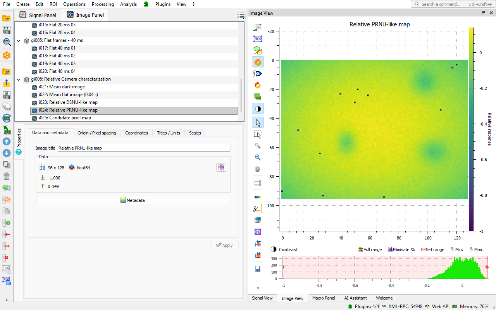

# Getting Started

[← Documentation index](README.md)

This page shows where the plugin appears in DataLab, how to run the quickstart, and how to prepare your own frames. DataLab Desktop and DataLab-Web work the same way.

## Where to Find the Plugin

- **Plugins > Camera & Detector Characterization** menu of the image panel: open the examples, run the methods and open the [camera simulator](simulator.md).
- **Applications** catalog, opened by the **Camera & Detector Characterization** tile of the welcome page. It lists each method with the inputs it expects, tells whether the current selection can run it, and offers its examples. **Try with this example** opens an example, prefills the parameters and runs the method.
- **Open quickstart example** tile of the welcome page.

## Run the Quickstart

1. Choose **Plugins > Camera & Detector Characterization > Open quickstart example**. DataLab loads 20 images in five groups and selects them. If the workspace is not empty, it asks before replacing it.
2. Choose **Run camera characterization...**.
3. Accept the parameters.

The plugin assigns each image to the dark or flat frames from its metadata. DataLab asks you only when the assignment is ambiguous or the campaign is invalid.

The quickstart is a synthetic campaign of 96 × 128 frames from one sensor:

- 4 dark frames, shutter closed: bias, row and column banding, amplifier glow in the lower-right corner, read noise, dead and hot pixels;
- 4 flat levels at 5, 10, 20 and 40 ms, with 4 frames each: a uniform illuminated field with vignetting, three dust shadows, PRNU and shot noise.

DataLab then adds:

- in the signal panel, the response curve with its metrics table, the row and column profiles and two distributions;
- in the image panel, the mean dark and flat images, and the DSNU-like, PRNU-like and candidate-pixel maps.

[Relative characterization in LSB](relative-dn.md) explains each result.

## Other Examples

| Menu item | Example | Methods |
| --- | --- | --- |
| **Open photon transfer example** | 16 exposure levels up to ADC saturation | [Photon transfer curve](photon-transfer.md), [relative characterization](relative-dn.md) |
| **Open dark-ramp example** | Dark frames from 0.5 s to 8 s | [Dark current and hot pixels](dark-current.md) |

Both examples are generated in memory. Run them with **Run photon transfer analysis...** and **Run dark-current analysis...**.

## Use Your Own Frames

Use linear camera output before gamma, automatic gain, rescaling or denoising. Select frames from one sensor, gain, readout mode, binning and physical ROI. Equal array dimensions alone do not ensure that the same pixels were measured. The simulator and the bundled examples provide the acquisition declarations; for an import, supply them from the acquisition record:

| Key | Value | Use |
| --- | --- | --- |
| `plugin.org.datalab.camera-characterization.exposure_time_s` | Exposure time in seconds, finite and non-negative | Required on flat frames (relative-LSB and photon transfer) and on dark frames (dark current) |
| `plugin.org.datalab.camera-characterization.frame_role` | `dark` or `flat` | Used for automatic assignment. Otherwise assign the frames to the appropriate input slot yourself; an exposure time does not establish that the shutter was open. |
| `plugin.org.datalab.camera-characterization.saturation_dn` or `.bit_depth` under the same prefix | Native clipping code or ADC depth | In automatic mode the ceiling comes from the acquisition, not the image maximum. For an import without this information, enter the native rail explicitly. |
| `plugin.org.datalab.camera-characterization.bit_shift` | Number of unused low bits | `0` for native right-aligned codes; `4` for 12 useful bits left-aligned in 16-bit words. Set the shift explicitly if the encoding is ambiguous. |

Set the metadata with **Edit > Metadata > Add metadata...**. Use `LSB` or its historical label `DN` for native camera codes. For an old file without a Z unit, confirm that it contains ADC codes; a file already converted to volts cannot simply be relabelled. The saturation threshold and any conversion gain (e⁻/LSB) refer to native codes, including for left-aligned data.

When importing untagged frames, assign each series to its slot in the input dialog. If the dialog warns about missing declarations, continue to the recipe parameters: confirm the ADC unit, enter the native rail and alignment as needed and, for the illuminated methods, specify the common exposure of a single unlabelled dark series or select a labelled dark reference. Use the acquisition record, not a guess. An unresolved warning stops the calculation without creating outputs; conflicting metadata or incompatible geometry must be corrected at the source or by changing the selection.

To read the exposure time from titles such as `Flat 5 ms 01`, select the frames and set:

| Field | Value |
| --- | --- |
| Metadata key | `plugin.org.datalab.camera-characterization.exposure_time_s` |
| Value pattern | `{title}` |
| Extraction pattern | `([\d.]+)\s*ms` |
| Conversion | Float |
| Scale factor | `0.001` |

`Flat 5 ms 01` gives `0.005`. The preview shows each value before you click OK. For titles in seconds such as `Dark 0.5 s 01`, use the extraction pattern `([\d.]+)\s*s\b` and a scale factor of `1`.

To set the frame role, select the dark frames, then set the key `plugin.org.datalab.camera-characterization.frame_role`, the value pattern `dark` and the String conversion. Repeat with `flat` for the flat frames. Label the actual exposures on the dark stacks as well: relative characterization and photon transfer can then distinguish a single reference from darks matched to each flat exposure.
